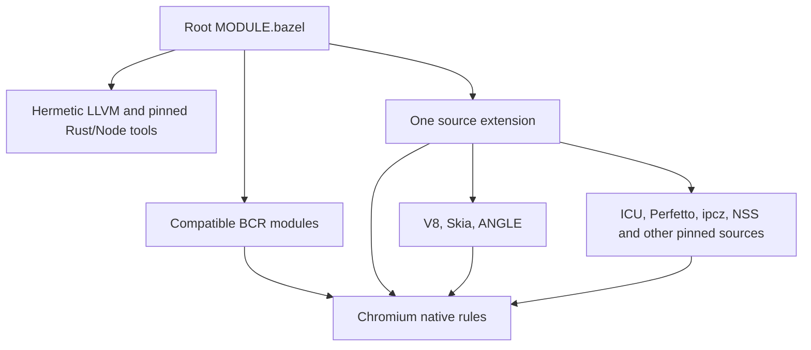

# Combined Chromium workspace

Root `MODULE.bazel` owns dependencies and toolchains. `dependencies.bzl` projects
all implemented dependency overlays over cached pinned source archives. Rule edits
regenerate directory projections without extracting source archives again. Existing
`overlays/` directories hold source lists, rules and patches; separate registry
entries are not needed to build.

The combined Linux x86_64 build selects hermetic LLVM’s glibc 2.31 platform.
The pinned Debian Bullseye desktop interfaces require symbols newer than the
toolchain’s default glibc 2.28. Host tools retain their execution toolchain.



Abseil and BoringSSL remain module dependencies so Protobuf and other BCR
consumers resolve the same libraries. Root archive overrides apply existing
Chromium patches and expose the same tested adapters. `update_combined_patches.py`
regenerates only their additional target/test files.

`tools/stage_compatibility_modules.py` stages the remaining 13 compatibility
updates together, using resolved source files from a tested build. It preserves
upstream archive checksums, pins dependency versions from that build and records
patch provenance. Registry files and upstream patches are integrity checked.
Chromium's native XSLT candidate replaces the libxslt override separately.

```sh
python3 tools/stage_compatibility_modules.py \
  --external-root /path/to/bazel-output-base/external \
  --target-registry /path/to/combined-registry
```

The staged entries load in an independent consumer; its cpuinfo runtime test
passes with hermetic LLVM. BCR submission still needs presubmit jobs and the
Chromium module's remaining source/dependency packaging.

QUICHE retains its exact DEPS revision, all 313 Chromium sources, original
platform overrides and Chromium URL library. Sources are projected under their
original `net/third_party/quiche/src` paths. No standalone GoogleURL dependency.

WebRTC, PDFium and browser integration remain pending.
Browser executable, remaining browser graph and runtime assets are unfinished.
`//:components` builds available components; it does not stand in for Chromium.

Repository layout follows [hermeticbuild/nodejs](https://github.com/hermeticbuild/nodejs):
one module extension, pinned source projections, native rules for bundled
dependencies, shared toolchains and component runtime checks.

Network and SQL now build inside Chromium: 565 original net translation units,
685 newly imported C/C++ units across the remaining network closure, and 17
native generator actions. Existing QUICHE supplies its original 313 sources and
protocol helpers. Native host executables generate certificate roots and HSTS
preloads from original inputs.

Chromium SQLite keeps commit `7d348fc79216a09b864ff881d8561a6222301666`,
`chrome_` symbol renaming, ICU and captured safety flags. NSS continues using
shared BCR SQLite. Git pins the Chromium fork because GoogleSource tar file
modification times change its archive checksum.

GSSAPI consumes two headers from Chromium's pinned Linux SDK. LLVM supplies the
C/C++ runtime and libc headers. Chromium's original Kerberos backend loads its
platform library at runtime. GSSAPI support remains enabled.

Runtime coverage includes real HTTP/HTTPS requests, TLS 1.3, unknown-CA rejection,
explicit trusted-root verification, 65,537-byte binary bodies, Brotli/Zstd decoding,
corrupt frames and conflicting Content-Length headers. Original truncated-Zstd
EOF behavior is retained: the read finishes and its decoding-error histogram
increments. SQLite tests cover transactions, binary data, ICU conversion, strict
SQL parsing, API armor and coexistence with NSS's SQLite.

Geometry and range retain all 47 C++ units across 11 original targets, including
transforms, rounded rectangles, Skia conversions and Mojo traits. The math bridge
uses the full captured Chromium Skia provider and its public header configuration.

Dawn API headers, procedure/thread dispatch and common support now build from
commit `cee9cb0d67e749bf42f5e90cb3b8a6f525dbb920`: 20 C++ units, eight targets,
ten native generator actions. Upstream Jinja templates and output-inventory
checks remain unchanged. The version hook input is the pinned commit hash.
This supplies Skia's Dawn API dependency; GPU implementations remain pending.
BCR Vulkan-Headers 1.4.349 supplies headers; backend compatibility still needs
validation when those consumers are ported.

Chromium's original Fontations (`font-types` 0.10, `read-fonts` 0.35,
`skrifa` 0.37) and PNG 0.18 dependencies share native Rust rules. The full crate
group now contains 55 targets and seven original build scripts. Tests draw Ahem
outlines, decode independent PNG pixels and reject malformed font/PNG data.
Dawn tests check generated C++ ownership, dispatch/thread isolation and fatal
assertions; they do not exercise a GPU backend.

The native font closure now retains FreeType's pinned fork/custom modules,
HarfBuzz's ICU/configuration, Fontconfig 2.17.1 with Fontations, Chromium PNG
1.6.43 limits and patched XML 2.14.2. Seven captured targets compile 171 C/C++
units, using separate C and C++ flags. BCR libuuid 2.41.2.bcr.1 supplies UUIDs.
Native bindgen preserves both original Fontconfig allowlists and its wrapper.
Parser-only `FC_NO_MT`/visibility macros are clang arguments, never propagated
into production C; all 29 Fontconfig compile actions were checked.

Font tests cover glyph rasterization, LTR/RTL shaping, ICU Unicode properties,
XML-based family aliases, matching through both FreeType and Fontations,
malformed font rejection, PNG pixels/limits and XML parsing failures.

Image codecs now retain all 213 original C/C++ units and 27 JPEG SIMD objects
across 25 captured targets. Native actions invoke BCR NASM 2.16.03 with original
PIC, ELF and reproducible-output flags. JPEG keeps Chromium symbol mangling and
8/12/16-bit implementations; WebP keeps the pinned post-1.6.0 revision; Wuffs
keeps Chromium's GIF/LZW module selection. No runtime GN/Ninja/CMake invocation.
Runtime tests cover lossy and high-bit-depth lossless JPEG, WebP alpha pixels,
animated-container mux/demux/frame decoding, GIF pixels and malformed inputs.

Potential shared work with hermeticbuild/nodejs is V8 rule/toolchain adapters,
Inspector Protocol/CRDTP, ICU compilation/data rules and Google zlib helpers.
Source revisions, ICU data and embedder profiles stay separate. Compatible
compression/numeric libraries should continue using shared BCR modules.

Full captured Chromium Skia now compiles 1,138 C++ units across 17 targets,
including Ganesh, Graphite, GL/Vulkan/Dawn integration, SkSL, PDF and Skottie.
Native actions generate GPU workarounds and both CXX bridges; Rust supplies
Fontations and PNG. Source projection reuses the pinned Skia archive while
removing upstream Bazel package boundaries. BCR libexpat 2.7.1.bcr.1 supplies
Expat. Platform graphics headers come from Chromium's pinned Linux SDK;
LLVM continues supplying libc and the C++ runtime. GPU execution and browser
integration remain unverified.

`//:skia_runtime_test` verifies Fontations glyph advances/outlines, raster text
pixels, Rust PNG encoding with both libpng and Rust decoding, truncated-input
rejection, PDF font embedding and fatal Chromium Skia assertions. Geometry also
passes against this full provider. GPU execution remains unverified.

## Compositor paint

`@chromium//native:paint` retains the complete captured `//cc/paint:paint`
closure: 31 targets, 213 C++ units and two Crashpad assembly sources. It shares
existing Skia, networking, Mojo and geometry implementations. New sources cover
compositor helpers/debugging, animation, color management, HDR/Skia Mojo traits,
Linux UI/display types, crash keys and Crashpad client/util support. Crashpad
uses Chromium base through its original adapter; no mini_chromium substitute.
Original assembler flags and the ELF Crashpad info note remain intact.

`//:paint_runtime_test` checks every raster pixel from clipped/transformed nested
records, serializes through the production renderer-to-raster format and checks
decoded pixels. Truncated/invalid operations and insufficient output capacity
must fail. Color checks cover sRGB/Skia conversion and HDR classification; crash
keys exercise real Crashpad annotation registration, lookup and clearing.
Crash handler startup, GPU execution and browser assembly remain unverified.

## Linux graphics consumers

`@chromium//native:gfx` now builds the full captured `//ui/gfx:gfx` closure.
Thirteen additional targets retain 90 C/C++ units plus the original Python DRM
format-table action. Dependencies reuse the existing paint, geometry, font,
codec, Mojo and Skia providers. Added code includes image representations,
screenshot codecs, color utilities, native buffers/fences, resource packs and
Google zlib compression helpers. C and C++ keep separate captured compiler flags.

DRM and sync have no BCR modules at this audit. Source repositories use exact
Chromium DEPS pins: libdrm `ad78bb591d02162d3b90890aa4d0a238b2a37cde` and
libsync `f4f4387b6bf2387efbcfd1453af4892e8982faf6`. Declared header providers
preserve original include paths; native Python generates the DRM modifier table.

`//:gfx_runtime_test` checks PNG alpha pixels, image-representation conversion,
JPEG/WebP screenshot pixels, ICC profile round trips and malformed inputs. It
writes and loads binary resource packs with aliases, including gzip-compressed
packs, and rejects truncated headers. Linux checks cover fence-handle ownership,
sync polling/invalid descriptors, DRM format lookup and invalid-device handling.
Pipe descriptors exercise ownership/polling without requiring a GPU. GPU-backed
fences, actual display operation and browser assembly remain unverified.

## Tint shader translation

`@chromium//native:tint` builds the complete captured Tint API closure from the
same pinned Dawn revision: 72 targets and 433 C++ units. Original WGSL reader
and WGSL/SPIR-V/GLSL/HLSL/MSL writers remain enabled; the SPIR-V reader retains
its captured disabled setting. Public feature flags match library compilation.
Source projection shares Dawn's archive and removes upstream Bazel packages.

BCR `spirv_headers@1.4.341.0` supplies C/C++ headers through one adapter;
`spirv_tools@2026.1` supplies native validation/optimization. Its native build
requires `rules_python@1.9.0`, now selected by the combined root module. No
Tint source patches, prebuilt shader tools or foreign build actions are used.

`//:tint_runtime_test` parses/validates WGSL, prints and reparses it, and emits a
storage-buffer compute shader through every captured output backend. Independent
SPIR-V validation/optimization and ANGLE GLSL compilation check generated output.
Bounds clamping survives optimization. Tests also
reject WGSL syntax/type errors and corrupt SPIR-V. HLSL/MSL emission is checked;
platform compiler execution remains unverified. WGSL/SPIR-V execution is now
covered by the SwiftShader tests below.

Dawn runtime edges are now recovered from upstream GN evaluation. The native
library separates `data_deps` from C++ link inputs. Loader and validation
library/JSON artifacts and SwiftShader now build natively.
No backend flags were disabled. Browser runtime assembly must include those
real artifacts; the requirements manifest does not provide them.

## Dawn native library

`@chromium//native:dawn_native_library` compiles all 190 additional C++ units
across eight captured targets, including OpenGL, desktop GL, GLES, Vulkan and the
original null backend. Four native Python actions generate loader/validation/
feature/structure sources from original templates and expected-output inventories.
BCR Vulkan utility headers 1.4.349 join matching Vulkan headers and SPIR-V tools.

Nested Khronos sources use Dawn's exact DEPS pins: EGL-Registry
`7dea2ed79187cd13f76183c4b9100159b9e3e071` and OpenGL-Registry
`5bae8738b23d06968e7c3a41308568120943ae77`. Their XML inputs and headers are
separate pinned source repositories; neither has a BCR entry at this audit.

`capture_dawn_runtime_edges.py` evaluates original GN `data_deps`, restoring the
maintainer source after success or failure. Source/graph hashes bind the committed
`native/dawn_runtime_edges.json` to this capture. Import rejects mismatched inputs.
The generated `dawn_native_runtime_requirements` manifest retains Vulkan loader,
SwiftShader and validation library/JSON dependencies. All four runtime dependencies now build through `dawn_native_runtime`. The manifest
is not a complete browser runtime bundle.

`//:dawn_native_runtime_test` uses the captured null backend to check real native
instance/device creation, zeroed buffer allocation, mapped-byte preservation,
asynchronous mapping, compute pipeline/command submission and scoped validation
errors for invalid buffer usage and WGSL types. Software-Vulkan execution now passes through SwiftShader; final browser runtime
assembly remains unfinished. Captured backend, assertion and validation flags stay
unchanged; Vulkan/SwiftShader/validation-layer flags remain enabled.

## Vulkan runtime artifacts

`@chromium//native:libvulkan.so.1` builds all 15 captured C units from loader
commit `f703f919c30c5b67958d35d40a4297cb3823ed78`, with original Xlib/XCB/Wayland,
Linux sorting and loader-search settings. Native `cc_import` exposes its link
interface. The binary retains its SONAME, RELRO/NOW and non-executable stack;
its dynamic dependencies contain only the target Linux runtime libraries.

`@chromium//native:vulkan_validation_runtime` builds the validation library and
original `angledata/VkLayer_khronos_validation.json`. It retains all 198 layer
C++ units plus 11 utility units across five captured targets. Source pins are
validation layers `83d96b88de7b85c3f29545170857e54e348421b2` and utility libraries
`4322db5906e67b57ec9c327e6afe3d98ed893df7`. BCR utility 1.4.349 renamed the NV
memory-decompression diagnostic helper required by the captured layer. Its exact
utility profile avoids changing validation behavior; Dawn still uses tested BCR
utility headers. Both components reuse native BCR Vulkan and SPIR-V providers.

The original Python JSON generator preserves layer version 1.4.328 and relative
library paths. `//:vulkan_validation_runtime_test` resolves those paths to the
actual native shared object, opens it, negotiates loader interfaces and checks
layer/extension discovery through the native loader. `//:vulkan_loader_runtime_test`
verifies the loaded library's identity, global Vulkan entry points, API version,
unavailable/malformed driver handling and Dawn's Vulkan discovery with validation
assets present. That negative-path test intentionally has no usable ICD; successful
software-Vulkan compute/raster calls are covered below. Browser assembly remains
unfinished.

## SwiftShader execution

`@chromium//native:libvk_swiftshader.so` builds the captured SwiftShader driver
from `5f1c459a11bb4899301e89609cbf7547f9f31e20`: 174 C/C++ units and one Marl fiber
assembly unit across 16 targets. Hermetic LLVM compiles the original Subzero JIT
and vendored LLVM support sources. The captured configuration does not use the
alternative LLVM JIT backend. Vendored Marl stays pinned with SwiftShader;
source processing removes only its upstream Bazel package boundaries.

Compatible native BCR providers supply SPIR-V tools/headers, Wayland 1.24.0.bcr.1
and libffi 3.4.7.bcr.5. Wayland scanner/protocol generation and configuration
checks use native compiler actions. No GN/Ninja/CMake invocation occurs in builds.
The driver's original version script, Bsymbolic, SONAME, RELRO/NOW and
non-executable stack remain intact. Dynamic exports contain only its four Vulkan
entry points; its C/C++ sources match the captured revision byte for byte.

`@chromium//native:swiftshader_runtime_test` lives beside the captured `angledata`
layout. It selects a real SwiftShader CPU Vulkan adapter through Dawn and the
native loader, requires the native validation library to be loaded, dispatches
WGSL compute and checks all 32 result words. A separate vertex/fragment pipeline
rasterizes a full-screen triangle; every copied RGBA pixel must be exact green.
Both paths report zero Dawn errors. The test preserves `VK_LAYER_PATH` while
Dawn temporarily scopes its own discovery environment. No null/mock driver is
used. Physical GPU execution and Skia GPU context integration remain unverified.

`//:wayland_runtime_test` exchanges a real client/server core-protocol sync over
a socketpair, exercising generated protocol and libffi callbacks. No display
server is required. `@chromium//native:dawn_native_runtime` now exposes all four
captured runtime artifacts: loader, SwiftShader, validation library and layer JSON.
It also includes SwiftShader’s Linux ICD JSON, generated by the original pinned
`write_icd_json.py` action. The SwiftShader runtime test loads this manifest
unchanged, checks its relative driver path, then performs compute and raster
readbacks with validation loaded.
Browser/Blink assembly, browser `--version` and headless page load remain unfinished.


ANGLE runtime edges are recorded in
`overlays/chromium/native/angle_runtime_edges.json`. Regenerate with
`overlays/chromium/tools/capture_angle_runtime_edges.py` using the same source
checkout, GN binary and captured graph. This maintainer command temporarily
instruments ANGLE templates and restores their source even when GN fails.
Native Bazel builds do not run GN. The catalog distinguishes EGL’s GLES runtime
library and Vulkan’s SwiftShader/validation data from C++ link dependencies;
the catalog is checked against source and graph hashes before import.

`@chromium//native:angle_runtime` builds native `libEGL.so`/`libGLESv2.so`,
SwiftShader, the Vulkan loader, validation library/JSON and the captured optional
mock ICD/JSON. The mock artifact preserves the original bundle; pixel tests use
SwiftShader’s Subzero driver. All 469 ANGLE/VMA C/C++ translation units retain
the captured profile, including GL, Vulkan, null and Dawn backends. The two
original Python actions generate commit and shader-program version headers.

BCR supplies native X11/Xi/Xext/XCB, Wayland and SPIR-V implementations. VMA
uses Chromium’s exact `cb0597213b0fcb999caa9ed08c2f88dc45eb7d50` fork because
no BCR module exists. Vulkan tools uses Chromium’s exact
`d643b80d6ba8c191bc289fdda52867c3bb3c190b` revision. Native pciutils 3.7.0
matches the SDK’s library version and copies its Linux configuration; libudev
remains a target-system platform library, linked through the pinned SDK’s
interface. The SDK interface is not bundled as a runtime implementation.

`@chromium//native:angle_runtime_test` loads the native EGL/GLES libraries,
creates a SwiftShader Vulkan pbuffer context, compiles and links GLSL shaders,
draws a full-screen triangle, reads every RGBA pixel and rejects invalid GLSL.
Physical GPU and window-system display execution remain unverified.


## GPU command protocol

`@chromium//native:gpu_command_common`, `:gpu_gles2_commands`,
`:gpu_gles2_utils` and `:gpu_gles2_interface` build the captured GPU command
protocol and GLES2 interface. `:viz_shared_image_format` and `:gl_enums` provide
its image-format and GL-enum dependencies. The importer preserves all 29 new
C/C++ translation units, reuses native base/Mojo/Skia/ANGLE providers and the
existing mailbox implementation, and uses BCR UUID/Expat for inherited Skia
link requirements.

`//:gpu_protocol_runtime_test` maps one shared-memory region twice and forks a
service process. It sends a real DrawArrays command structure and 64-bit sync
token through that memory, then exercises client/service discardable-handle
locking and deletion across processes. It also rejects out-of-range/overflowing
buffer accesses, misaligned handles and overflowing pixel-pack layouts, and
checks odd-sized NV12/P010 planes and Skia plane color types. It does not execute
the GPU service decoder; its native build now passes, while shader rendering
is covered by the ANGLE runtime test.

Chromium’s full `//ui/gl:gl` wrapper still needs Linux UI/X11 and tracing/metrics
ports. Its original runtime-only edges are captured in
`overlays/chromium/native/gl_runtime_edges.json`; regenerate with
`capture_runtime_edges.py --target //ui/gl:gl` using the pinned source, GN and
captured graph. This maintainer command restores the GN source on success or
failure. Native Bazel builds do not run GN. The Linux profile selects system
GBM (`use_system_minigbm = true`); the captured minigbm target is an empty group,
so its platform interface must be preserved when the wrapper is imported.


## X11 connection and protocol

`@chromium//native:gfx_x11` builds Chromium’s captured X11 connection library,
its platform-event sources and generated protocol implementation: 41 C/C++
translation units, two original Python loader actions and 31 native copies.
The captured `regenerate_x11_protos = false` profile copies the checked-in
protocol files to their original generated paths. No protocol stub replaces
those sources.

BCR XCB 1.17.0 supplies the client transport. The root module applies
`build/libxcb-abstract-sockets.patch` to enable Linux abstract sockets, which
BCR’s config template disables. This restores the normal Linux transport and
allows the sandboxed test to reach its private Xvfb server without filesystem
socket mounts. Chromium’s adapted keysym constants and three included keyboard
implementation fragments remain exact: they are compiled inside Chromium’s C++
namespace and cannot be replaced directly with stock Xlib source files.

```sh
python3 tools/run_x11_integration.py -- --jobs=4
```

The runner needs host Xvfb as a test fixture, creates an unused display with TCP
disabled, runs the native Bazel test without cached results and stops its server
on success or failure. Compilation and test execution remain sandboxed. The test
checks real window creation/mapping, geometry, lowercase/shifted key translation,
binary property round trips with embedded NUL, property events, a 1 MiB property
transfer, protocol errors for invalid resources and graceful missing-display
handling. The manual test target is separate from the display-free runtime suite;
CI runs both. Chromium GL now renders through the native wrapper; Browser assembly remains pending.


## Linux graphics buffers

`@chromium//native:linux_gbm`, `:linux_drm`, `:native_pixmap_usage` and
`:x11_gpu_memory_buffer_support` build the captured six C++ translation units
for DRM formats, GBM devices/buffers, native pixmap usage and X11 DRI3 support.
They reuse the native X11, libdrm and shared-image-format providers.

The original Linux profile uses system GBM. Its captured Minigbm target is an
interface group, so the port preserves that group and links the pinned SDK’s
`libgbm.so` interface with `system_provided = True`. The SDK interface is not
bundled as a runtime implementation. BCR currently has no GBM/libgbm/Mesa module.
The target system supplies `libgbm.so.1`, as it does for the original GN build.

`//:linux_buffers_runtime_test` checks independent DRM FourCC values and reverse
conversions for RGBA/BGRA/NV12/P010, native pixmap/GBM scanout and CPU-access flags,
real system-library loading and rejection of an invalid DRM descriptor.
The private Xvfb integration also verifies X11’s missing-DRI3 path: no GBM device
or supported configurations are reported, and native buffer allocation fails
cleanly. Real DRM-device allocation and DMA-BUF import/export remain unverified.
CI installs the platform `libgbm1` runtime before running these checks.


## Shared browser services

`@chromium//native:browser_metrics`, `:browser_tracing`, `:prefs` and `:variations`
build the captured shared services needed by Linux UI and the browser. The
combined import adds 163 C/C++ translation units and two original generator
actions with 97 C++/Python/JavaScript outputs. Existing variations seed and
Perfetto protocol libraries are reused; generated Mojo sources retain their
captured profile. Browser metrics schemas come from Chromium’s source archive.

The native protobuf JavaScript plugin uses Chromium’s exact
`e6d763860001ba1a76a63adcff5efb12b1c96024` source pin; no BCR module exists.
Its three C++ files compile with hermetic LLVM against the shared BCR Protobuf
compiler library. Only an upstream Bazel package boundary is removed during
source packaging. As in the network port, the importer omits
`-fcomplete-member-pointers` for compatibility with Protobuf 33’s constexpr
metadata. Runtime checks remain enabled. BCR Snappy `1.2.2.bcr.3` is reused with
a namespaced header adapter.

`//:browser_services_runtime_test` checks real JSON preference persistence,
managed-policy precedence, observer notifications (including masked writes),
corrupt JSON fallback, metrics serialization, variation-ID time/collection
filtering, Snappy golden-block decoding and truncated-input rejection. It also
frames real Chrome trace packets through Perfetto, splits headers and payloads
across arbitrary chunks, validates reassembly and delayed completion of truncated
packets, and checks privacy filtering in the default tracing configuration.
The generated client-variations JavaScript passes pinned Node syntax checking.
The captured Linux UI/GL closure now builds; Browser process assembly remains pending.


## Chromium GL and Linux UI

`@chromium//native:chromium_gl`, `:ui_base`, `:ui_events`, `:ui_x11` and
`:gfx_mojom` build the remaining captured Linux UI/GL closure: 351 C/C++
translation units, one original locale-list action and existing GRIT/Mojo
outputs. GL’s five runtime dependencies remain separate from C++ link inputs;
`:gl_runtime` supplies the native ANGLE/SwiftShader/Vulkan bundle. The importer
checks `gl_runtime_edges.json` against source and graph hashes.

BCR xkbcommon `1.9.2.bcr.beta.2` builds from source with native Bazel compiler
checks and native Bison generation. Its header, consumer-link and in-memory
compose tests pass and are included in the root runtime suite. Chromium’s
Khronos header snapshot remains exact. No source backend or runtime check is
disabled to build the wrapper.

`@chromium//native:gl_runtime_test` creates a real Chromium-managed EGL display,
pbuffer and ES3 context over SwiftShader. It uses Chromium’s GL dispatch to
compile/link ES3 shaders, upload a vertex buffer, draw a triangle and verify all
pixels. The context keeps its original validation default. The test verifies
Chromium’s current-context tracking and performs normal context/surface/driver
cleanup. Physical display/GPU execution and browser/Blink assembly remain
unverified.


## Ozone and platform GL initialization

`@chromium//native:ozone` and `:gl_init` add 411 C/C++ units across 120 captured
libraries/groups/tools. Headless, X11 and Wayland remain enabled. All 39 native
generator actions run original scripts: 34 Wayland protocol actions, the URL
spoof-check dictionaries/trie and the two Ozone platform/constructor lists.
The trie generator is a native host executable with declared ICU data.

BCR Wayland supplies its native scanner and client/cursor/EGL libraries.
Protocol XML retains Chromium's standard and KDE DEPS pins; Chromium-owned
protocols stay in its source archive. `wayland-public-headers.patch` exposes the
BCR-generated core headers for angle-bracket includes. SDK Wayland headers no
longer shadow that provider.

The captured desktop profile keeps system D-Bus, Pango/Cairo, ATK and udev through
SDK link interfaces marked `system_provided`. These interfaces are not runtime
libraries. `glib-shared.patch` builds BCR GLib, GObject, GModule and GIO as native
shared libraries with their standard SONAMEs. Desktop libraries and Chromium
then share one initialized GLib family; mixing static GLib with system GObject
previously failed before `main`. Non-Linux GLib linkage remains unchanged.

`:ozone_gl_runtime_test` initializes real headless Ozone UI/GPU support, selects
ANGLE/SwiftShader through the public GL factory, creates an offscreen ES3 context
and verifies every rendered triangle pixel. The direct Chromium GL test also
passes. Full Ozone X11/Wayland execution, physical display/GPU behavior and browser
assembly remain unverified.


## Chromium V8 profile

`@chromium//native:browser_v8` builds the captured Chromium V8 profile: 1,524
C/C++ units across 39 libraries/groups/tools and seven original generator actions.
The four host executables use the execution toolchain; Torque emits its complete
1,250-file inventory and mksnapshot produces external startup data and embedded
builtins. The source projection reuses the patched, pinned V8 archive.

This profile keeps Temporal, Perfetto, the V8 sandbox, pointer compression,
CppGC young generation and original heap/barrier checks. Both `DEBUG` and
`NDEBUG` are intentional captured defines. The standalone overlay retains its
upstream Bazel variants; its source list omits some browser features, so those
variants do not substitute for this profile.

Native Rust prerequisites now total 109 targets and 12 build scripts, including
Chromium's pinned Temporal C API, ICU4X calendar/locale data and time-zone
provider. Checked-in C++ bindings retain their versioning define.

`//:browser_v8_runtime_test` loads the generated snapshot and Chromium ICU data,
requires a securely configured sandbox, and checks that ArrayBuffer backing
memory belongs to its address space. JavaScript validates Temporal leap-day
arithmetic, historical DST and invalid-date rejection, Intl formatting and
Chromium word boundaries, BigInt, Wasm execution/truncation rejection and Promise
microtasks. Browser/Blink process integration remains pending.


## GPU service

`@chromium//native:gpu_service` builds all 355 captured C/C++ units across 66
libraries/groups: GLES2 and raster decoders, shared images, GPU configuration,
persistent cache, Dawn wire and libyuv. Four new original generator actions
produce disk-cache protocols, GPU control lists and Dawn wire code; existing
Dawn and workaround generators are reused. Generator dependencies now stage
reused generated outputs as declared inputs.

Libyuv retains commit `94417b9d213364905ce849c25719b819b8dbbaaa` and all 36
captured C++ units. Its provider exposes both standard and Chromium include
paths without changing source headers. Mojo uses the original GPU/Viz traits
and export headers. Native service compilation passes; command submission and
service decoder execution remain unverified.


## Media pipeline and storage

`@chromium//native:media` compiles the full captured media closure: 40 native
libraries/groups, 482 C/C++ units, four original Python actions and one native
CXX bridge. BCR codecs are shared. Exact DEPS repositories supply LevelDB,
libgav1 parser and CDM API headers. Symphonia keeps Chromium's FLAC-only profile;
Rust prerequisites now total 109 targets and 12 build scripts.

`//:media_runtime_test` validates exact FLAC PCM through Symphonia and Chromium's
handler, reset/malformed input, then real LevelDB snapshots, atomic batches,
lock exclusion, compaction and compressed persistence. ICU data and Linux audio
interfaces are declared dependencies. Combined components and 70 runtime tests
pass. Browser executable and headless page load remain pending.


## Compositor, network public interfaces and WebRTC

`@chromium//native:compositor` adds 2,008 captured C/C++ units and 14 Python
actions. Exact WebRTC/libsrtp/federated-compute pins live in
`compositor_sources.bzl`. XComposite and XTest use three native C units; XDamage,
XFixes, XRandR and XRender reuse BCR. X11 link providers preserve existing SDK
header contexts. Chromium WebRTC overrides, native task queues and its clock
provider are retained. Private SRTP/FFmpeg config headers stay scoped.

Combined components, 74 runtime tests, metadata/staging and the manual Xvfb
rendering/input checks pass. Blink/browser assembly remains unfinished.
