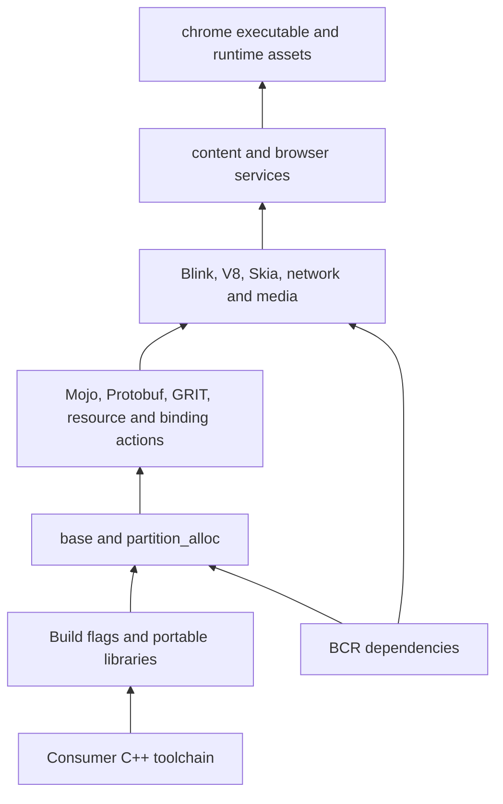

# Native browser migration

Goal: `bazel build @chromium//chrome:chrome` compiles full Linux x86_64 browser
with native Bazel actions. No foreign build backend. This target is not available yet.

## Work order

1. Foundation: source pin, registry staging, build flags, small native libraries,
   real compilation and consumer smoke tests. Current milestone.
2. Audit Chromium DEPS against BCR. For each replacement, record version, public
   headers, Chromium patches, defines, ABI assumptions and tests. Prefer existing
   overlays; do not substitute libraries solely because names match.
3. `base`, allocator and platform support. Use real feature flags and explicit
   source lists. Preserve checks, synchronization and allocator behavior.
4. Native generator actions: GRIT, Mojo, Protobuf, Blink bindings and V8 snapshots.
   Model host tools separately from target binaries; declare every input/output.
5. Rendering, networking and media. Map BCR modules after compatibility checks;
   keep Chromium-specific forks when required. Port their native build graph.
6. Browser executable, resources, locales, shared libraries and sandbox helper.
   Validate runtime assets, `--version`, headless page load and browser tests.

No placeholder `chrome` target, empty library substitutes, disabled safety checks,
or successful foundation build should be reported as browser completion.

## Dependencies to audit next

Abseil, BoringSSL, ICU, zlib, Brotli, libpng, libjpeg-turbo, libwebp, FreeType,
HarfBuzz, SQLite, Protobuf, RE2, Snappy, Zstd and libevent. Existing BCR overlays
must be checked against this Chromium revision's API and local patches before
adding them. Double Conversion is currently exposed through BCR with canonical
headers; Chromium call-site migration remains pending.
See [dependency overlay audit](../../docs/dependency-overlays.md) for missing modules,
module directories and Chromium DEPS pins.

## Validation limits

Foundation checks do not need depot_tools or a populated DEPS checkout.
Full browser requires the missing dependency graph, generators and platform
integration. Chromium's upstream Linux instructions call for at least 100 GB
free disk; a native migration also needs room for external repositories and
intermediate outputs.
