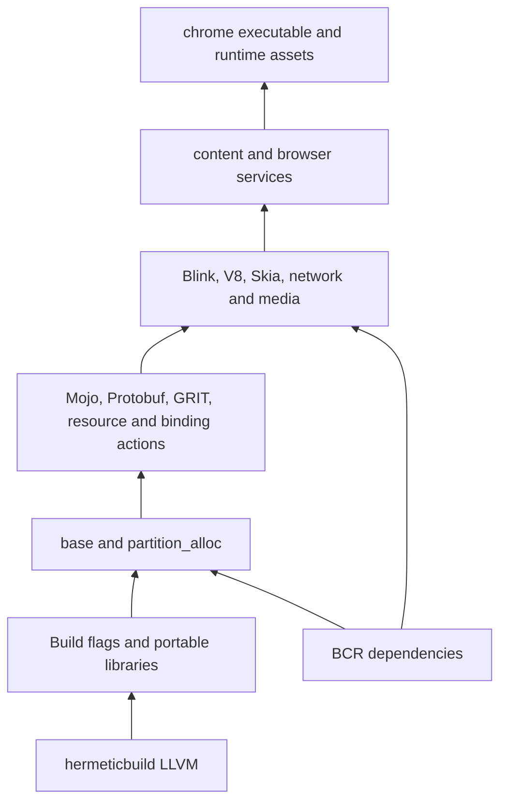

# Native browser migration

Main workspace: repository root. All implemented overlays share
`build/dependencies.bzl`; separate registry staging is no longer required.
Remaining dependencies are ported inside this combined workspace.

`bazel build --config=browser @chromium//native:browser_bundle` builds the full
Linux x86_64 browser with native Bazel actions and hermeticbuild LLVM. No foreign
build backend. Relocated Chromium 142.0.7444.59 passes version and headless HTTP
checks for external JavaScript/CSS, Unicode, Intl and layout with normal sandboxing.

Resolved Linux graph and initial native generator ports live in
[native/README.md](native/README.md). Snapshot preserves 16,619 targets and
4,753 captured runtime files; the native bundle adds declared platform libraries
and signed NSS module checksums.

## Work order

1. Foundation: source pin, registry staging, build flags, small native libraries,
   real compilation and consumer smoke tests. Implemented.
   Development and consumer harnesses use hermeticbuild LLVM (`llvm@0.8.26`).
2. Audit Chromium DEPS against BCR. For each replacement, record version, public
   headers, Chromium patches, defines, ABI assumptions and tests. Prefer existing
   overlays; do not substitute libraries solely because names match.
3. `base`, allocator and platform support. Use real feature flags and explicit
   source lists. Preserve checks, synchronization and allocator behavior.
   PartitionAlloc base/core/shim/raw-pointer libraries now compile natively;
   allocation and cookie-corruption consumer checks pass. Original Rust allocator,
   bindgen namespace wrapper, CXX bridge, and Chromium import macro now build
   natively with runtime integration tests. Perfetto's real browser tracing,
   service, IPC, JSON export and minimal storage graph also compiles. Full Linux
   `base` now compiles: 425 C++ sources plus seven support sources. Runtime test
   covers original Rust logger/JSON integration, file I/O, GLib event pumping
   and a ThreadPool reply. Twenty base/i18n sources now compile with original
   file-backed ICU startup, CED detection, locale/word-break/transliteration and
   streaming UTF-8 runtime checks.
   Shared hardened Abseil and BCR BoringSSL now expose Chromium's original
   include paths; verified native TLS 1.3 transfer passes.
   Original serde/lenient JSON wrapper now compiles through native Rust/CXX;
   parsing options and strict failures pass cross-language checks.
4. Native generator actions: GRIT, Mojo, Protobuf, Blink bindings and V8 snapshots.
   Model host tools separately from target binaries; declare every input/output.
   Full Mojo generator closure now builds natively, including Node/Terser.
   Native ipcz now compiles with actual base; original reference-driver tests
   verify node connections, binary/portal transfers and peer closure. Mojo core,
   its Chromium driver, embedding, platform/system and C++ bindings now compile
   natively. Runtime coverage includes real parent/child invitations, binary and
   shared-buffer transfer, generated InterfaceProvider RPC and malformed-message
   rejection. Complete Mojo base-type schemas and typemaps now compile. The URL
   library and production URL/origin traits preserve Chromium ICU and opaque
   origin identity. Captured browser interface consumers now compile.
   Native BCR Protobuf compiler/runtime generates Variations schemas; wire and
   bounds checks pass. All 87 Perfetto protocol actions generate 969 files using
   native compiler plugins; 480 generated C++ units compile. Original TraceConfig
   wire compatibility is tested across all three APIs. Captured Protobuf consumers,
   Blink bindings and browser integration now build. 186 native
   GRIT actions generate 14,913 outputs: locales, genders, image scales,
   compressed assets and tracing schemas. BCR Brotli streams pass original
   Chromium decoder checks. Native WebUI now supplies TypeScript, ESLint, wrappers,
   bundling, minification and GRD generation. Downloads-page pack and compiler
   rejection checks pass. Remaining 9 GRIT actions require code-cache, DevTools,
   Catapult tracing or credits producers.
5. Rendering, networking and media. Map BCR modules after compatibility checks;
   keep Chromium-specific forks when required. Port their native build graph.
6. Browser executable, resources, locales, shared libraries and sandbox helper.
   Validate runtime assets, `--version`, headless page load and browser tests.

No placeholder `chrome` target, empty library substitutes, disabled safety checks,
or successful foundation build should be reported as browser completion.

NSPR 4.29 and Debian-patched NSS 3.61 now have native overlays matching the
pinned Linux sysroot. NSS crypto, persistent key databases, FIPS policy and
integrity rejection tests pass. All 29 Linux crypto sources and five CBOR sources now compile. BoringSSL PKI
uses a build-only adapter. QUICHE now compiles all 313 original Chromium sources,
three generated protocol sources and the URI-template expander. Root runtime
checks cover HPACK, OHTTP, binary HTTP, malformed input and Chromium URL behavior.
Complete Linux net now compiles: 565 net sources and 685 new closure sources,
including DNS, SQL and native certificate/HSTS generators. Real HTTP/HTTPS,
TLS 1.3, certificate rejection/verification and stream-decoding tests pass.
Geometry/range, transforms, the Skia math bridge and their Mojo traits also
compile natively. Fontations and Rust PNG prerequisites, plus Dawn API/header
generators and procedure dispatch, now build inside the combined workspace.
The complete captured FreeType/HarfBuzz/Fontconfig stack now builds with native
Fontations bindings, Chromium PNG/XML configuration and BCR UUID. Rasterization,
shaping, matching and malformed-input checks pass. Full captured Skia now
compiles 1,138 C++ units with original GPU, PDF and font configuration. Dawn GPU
backends and the captured browser/renderer integration now build. JPEG (all precisions/SIMD),
WebP and Wuffs GIF now compile with native actions and runtime codec checks.
The full compositor paint closure adds 213 C++ units and two Crashpad assembly
sources. Nested-record playback/serialization, malformed-wire rejection, color
spaces and actual crash-key annotation checks pass. Browser assembly and headless HTTP checks pass. Full captured `ui/gfx` adds 90 C/C++ units and native DRM table
generation, with exact DEPS pins for DRM/sync. Image codecs, image conversion,
ICC profiles, binary/gzip resource packs and Linux fence ownership now pass
runtime checks. Tint's complete captured API now compiles 433 C++ units, retaining
WGSL and all captured output backends. WGSL/SPIR-V validation and independent
ANGLE compilation of generated GLSL pass. Dawn native backend compilation adds
190 C++ units and four native generators. Native device/mapping/validation tests
pass on the captured null backend. Vulkan loader and validation library/JSON
now build natively, with ABI/discovery/runtime-layout tests. SwiftShader adds
174 C/C++ units and native fiber assembly. Real Dawn/Vulkan compute and raster
readbacks pass on its CPU device with validation loaded. Browser/Blink assembly
and headless HTTP page checks pass.

## Dependencies to audit next

Brotli, libpng, libjpeg-turbo, libwebp, FreeType,
HarfBuzz, SQLite, Protobuf, RE2, Snappy, Zstd and libevent. Existing BCR overlays
must be checked against this Chromium revision's API and local patches before
adding them. Double Conversion is currently exposed through BCR with canonical
headers and original-path forwarding headers; base call sites compile.
Abseil, BoringSSL, ICU and zlib have component checks and build in the validated
browser. Broader feature and platform compatibility needs further testing.
See [dependency overlay audit](../../docs/dependency-overlays.md) for missing modules,
module directories and Chromium DEPS pins.

## Validation limits

Foundation checks do not need depot_tools or a populated DEPS checkout.
The captured Linux browser dependency graph, generators and runtime bundle
are implemented and validated. Other platforms and hosted BCR jobs are untested. Chromium's upstream Linux instructions call for at least 100 GB
free disk; a native migration also needs room for external repositories and
intermediate outputs.
